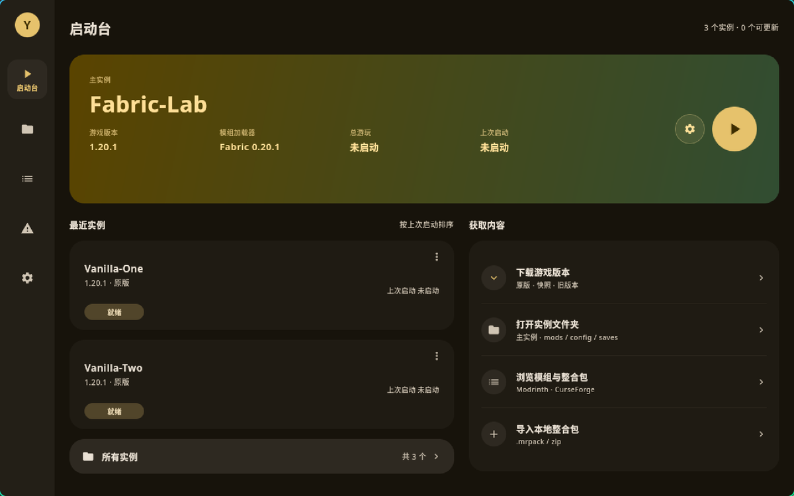
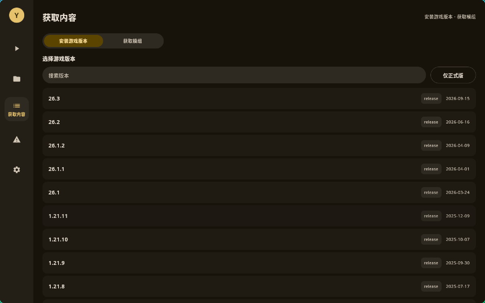
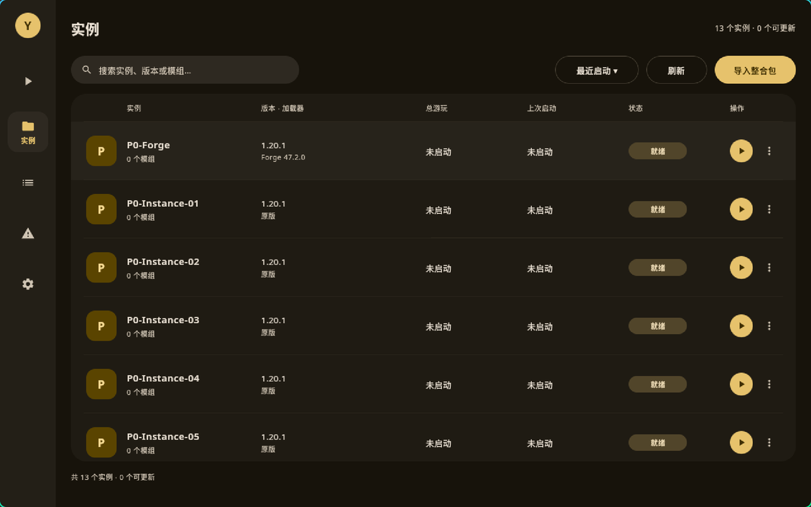

# YMCL · Yolk Minecraft Launcher

一个自己用的、也愿意给朋友用的 Minecraft 启动器。  
**Kotlin + Compose Multiplatform**，Material 3 界面，Windows / Linux 双平台，本地优先、无后端、不上传任何数据。

[](LICENSE)
[]()
[](https://github.com/Gallium-N/Yolk-Minecraft-Launcher/releases)



## 这是什么

YMCL（Yolk Minecraft Launcher）是一个桌面端 Minecraft 启动器：装版本、装加载器、装 Mod、导入整合包、管 Java、启动游戏。
界面从零重写，引擎沿用 [HMCL](https://github.com/HMCL-dev/HMCL) 的 HMCLCore。

设计目标只有三条：

1. **下载在国内能跑通** —— 默认走 BMCLAPI 镜像，可一键关掉；断点续传、停滞检测、失败清单。
2. **界面说人话** —— 每个动作都有明确的加载/成功/失败状态，不让你对着空白猜。
3. **出问题能说清为什么** —— 崩溃诊断（进行中），目标是"不是抛一堆堆栈给你，而是告诉你哪个 mod 的锅"。

## 界面

| 安装游戏版本 | 实例列表 |
|---|---|
|  |  |

## 功能状态

| 功能 | 状态 |
|---|---|
| 原版版本安装（含老版本的 virtual assets） | ✅ |
| 加载器：Fabric / Forge / Quilt / NeoForge | ✅ |
| 实例隔离（每个实例独立 mods/config/saves）+ 共享 assets/libraries | ✅ |
| 整合包导入：`.mrpack` 与 CurseForge zip | ✅ |
| Modrinth 模组搜索 / 依赖自动补齐 / 安装 | ✅ |
| Java 自动发现 / 按版本选择 / 缺失时自动安装（Adoptium + 国内镜像） | ✅ |
| 下载：BMCLAPI 镜像可关、并发、断点续传、失败清单 | ✅ |
| Material 3 界面 + 动效 + 「减少动效」开关 | ✅ |
| 崩溃诊断 | 🚧 解析层进行中，界面显示"开发中" |
| CurseForge 浏览（需要官方 API key） | ⏳ |
| YolkPack 离线迁移包 | ⏳ 方案讨论中 |
| 正版登录 | ⏳ |

## 下载

到 [Releases](https://github.com/Gallium-N/Yolk-Minecraft-Launcher/releases) 下载最新版本。

| 平台 | 文件 | 说明 |
|---|---|---|
| Windows | `YMCL-<版本>-win-x64.exe` | 单文件。双击后先解压到 `%LOCALAPPDATA%\YMCL\<版本>`（首次 1–3 秒），之后复用 |
| Windows | `YMCL-<版本>-win-x64-portable.zip` | 便携版，解压到任意可写目录，**不要**放 `C:\Program Files` |
| Linux | `YMCL-<版本>-x86_64.AppImage` | `chmod +x` 后直接运行 |

每个版本都附 `SHA256SUMS`，下载后可自行校验。**不需要预先安装 Java**：启动器自带运行时，游戏用的 Java 也会自动处理。

> ⚠️ Windows 会弹 SmartScreen（"Windows 已保护你的电脑"）——因为构建没有代码签名。
> 点 **更多信息 → 仍要运行** 即可。如果你不放心，用 portable zip 或自行从源码构建。

## 快速上手

1. 打开 YMCL，进 **获取内容 → 安装游戏版本**，挑一个版本（默认只列正式版）
2. 需要 Mod 就选加载器（Fabric / Forge / NeoForge / Quilt），不需要就留在「原版」
3. 填个名字，点安装。下载进度会显示文件数、速度和预计剩余时间
4. 装完回到 **实例** 页，点启动
5. 想加 Mod：**获取内容 → 获取模组**，选实例后搜索安装，依赖会自动补齐

已有整合包？直接把 `.mrpack` 或 CurseForge 的 zip **拖进窗口**，或者点「导入整合包」。

## 数据放在哪

便携优先——所有东西都在启动器旁边的 `.YMCL` 目录里：

```
<exe 所在目录>/.YMCL/
├── game/            # 游戏根：assets、libraries、versions
│   └── versions/<实例>/   # 每个实例的 mods、config、saves、日志
├── java/            # 启动器安装的 Java 运行时
├── data/            # 配置、缓存、索引
└── tmp/
```

- 想搬到别的电脑/硬盘：整个 `.YMCL` 拷走即可
- 卸载：删掉 exe 和 `.YMCL`，**不写注册表、不留残留**
- 如果所在目录不可写（例如 `Program Files`），会自动回退到 `%LOCALAPPDATA%\YMCL`

## 常见问题

**启动时闪退 / `Failed to launch JVM`**  
旧版本曾因为打包运行时缺模块而报这个；1.0.0 已修复。若仍出现，请到 Releases 下载 `console-debug` 版，用 cmd 运行并把输出贴到 issue。

**下载很慢或卡住**  
默认走 BMCLAPI。可在 **设置 → 下载** 关闭镜像改走官方源；两边都慢通常是出口网络问题，不是启动器。

**游戏崩溃了**  
崩溃报告在 `<实例>/crash-reports/`，日志在 `<实例>/logs/latest.log`。诊断功能还在做，目前先看 `logs/latest.log` 的最后 100 行。

**能不能装正版账号 / 联机？**  
登录还没做，当前是离线启动（适合单人和自建服务器）。联机请用服务端地址直连。

**会不会上传我的数据？**  
不会。没有后端，没有遥测，所有请求只发往 Mojang / BMCLAPI / Modrinth 这些下载源。

## 从源码构建

需要 **JDK 21**（不要用更新的大版本）和网络（Gradle 会拉依赖）：

```bash
git clone https://github.com/Gallium-N/Yolk-Minecraft-Launcher.git
cd Yolk-Minecraft-Launcher
export JAVA_HOME=/path/to/jdk-21

./gradlew run                 # 直接跑
./gradlew build               # 编译 + 全部测试
./gradlew createDistributable # 生成 app-image（自带运行时）
```

打包：

```bash
./gradlew createDistributable -Pymcl.version=1.0.0
# Windows: composeApp/build/compose/binaries/main/app/YMCL/YMCL.exe
# Linux:   .../app/YMCL/bin/YMCL
```

一键出 Windows / Linux 产物由 GitHub Actions 完成，见 `.github/workflows/build.yml`。

## 技术栈与结构

| 层 | 说明 |
|---|---|
| `composeApp/src/commonMain` | UI（Material 3）、领域模型、应用用例 |
| `composeApp/src/desktopMain` | 平台实现：文件、进程、HTTP、Java 扫描 |
| `vendor/hmcl/HMCLCore` | 引擎（vendor 副本，Java/Kotlin 源码未改动，仅重写构建脚本） |
| `design/` | 设计 token、界面稿、logo |
| `docs/` | 交接文档、阶段报告、能力矩阵 |
| `prompts/` | 各阶段任务书（给 AI 实现者用的规格） |

Kotlin 2.4.21 · Compose Multiplatform 1.12.2 · Gradle 8.14 · JDK 21

分层规则：`domain` 不碰 `java.io/nio/awt`；UI 不直接依赖引擎类型；所有网络请求必须经过
`DownloadSource`（镜像与官方源只在这一处切换）。

## 许可证与声明

本项目以 **GPL-3.0-or-later WITH AdditionRef-HMCL** 发布——因为引擎来自 HMCL，
修改版必须改名区分并保留其版权声明。完整条款见 [`LICENSE`](LICENSE)，
vendor 源码的来源与同步方式见 [`vendor/README.md`](vendor/README.md)。

> **NOT AN OFFICIAL MINECRAFT PRODUCT. NOT APPROVED BY OR ASSOCIATED WITH MOJANG OR MICROSOFT.**
>
> YMCL 不分发任何 Minecraft 游戏资源。所有游戏文件都由启动器从 Mojang 官方源或其镜像下载，
> 用户需自行拥有合法的 Minecraft 副本。Minecraft 是 Mojang Studios / Microsoft 的商标。

## 致谢

- [HMCL](https://github.com/HMCL-dev/HMCL) —— 引擎与大量踩坑经验
- [Compose Multiplatform](https://github.com/JetBrains/compose-multiplatform) —— 跨平台 UI
- [BMCLAPI](https://bmclapi2.bangbang93.com/) / [Modrinth](https://modrinth.com/) —— 下载与资源 API
- [Adoptium](https://adoptium.net/) 与 TUNA / 华为云镜像 —— Java 运行时

---

## English (short)

**YMCL (Yolk Minecraft Launcher)** is a desktop Minecraft launcher for Windows and Linux,
built with Kotlin + Compose Multiplatform (Material 3) on top of HMCLCore.

Install vanilla or modded versions (Fabric / Forge / Quilt / NeoForge), import `.mrpack` and
CurseForge modpacks, browse and install mods from Modrinth with automatic dependency resolution,
and let it manage Java for you. Downloads default to the BMCLAPI mirror (toggleable), with resume,
stall detection and an explicit failure list.

Portable by design: everything lives in `.YMCL` next to the executable; uninstalling means deleting
two things. No backend, no telemetry.

Build: JDK 21, then `./gradlew run` or `./gradlew createDistributable`.
Licensed under GPL-3.0-or-later (engine: HMCL). Not an official Minecraft product.
